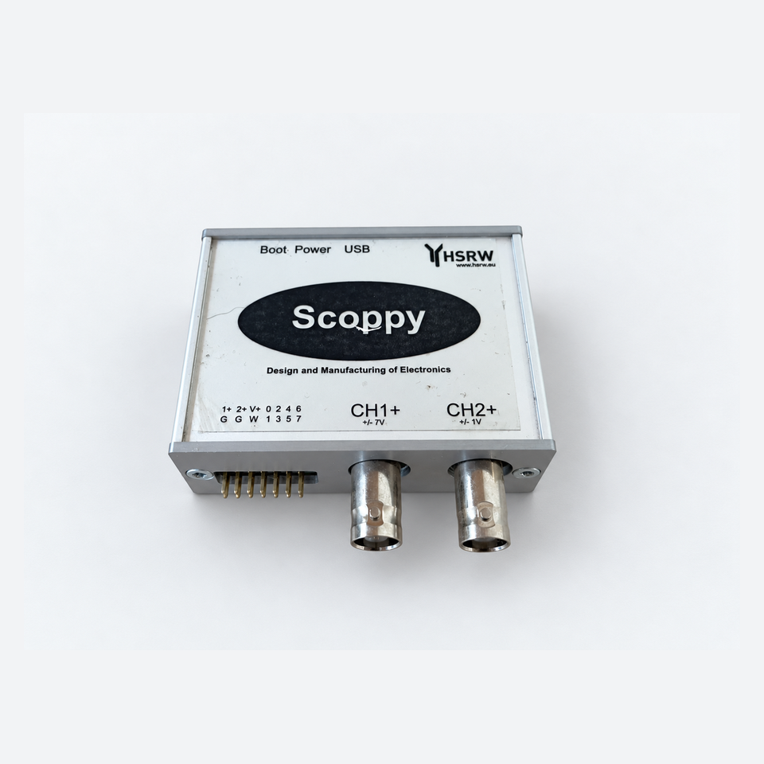
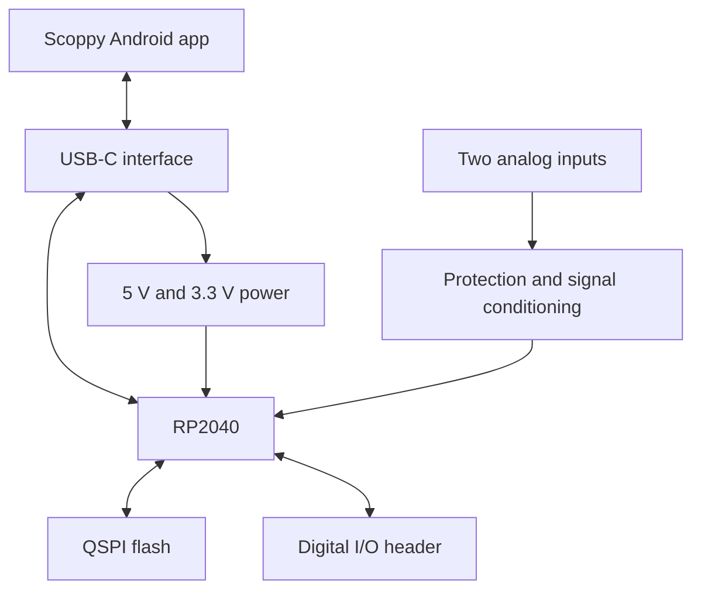
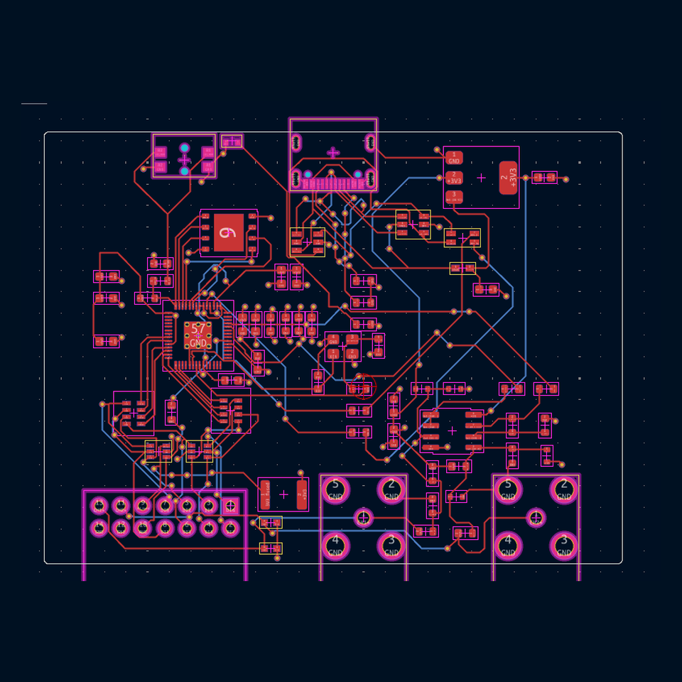
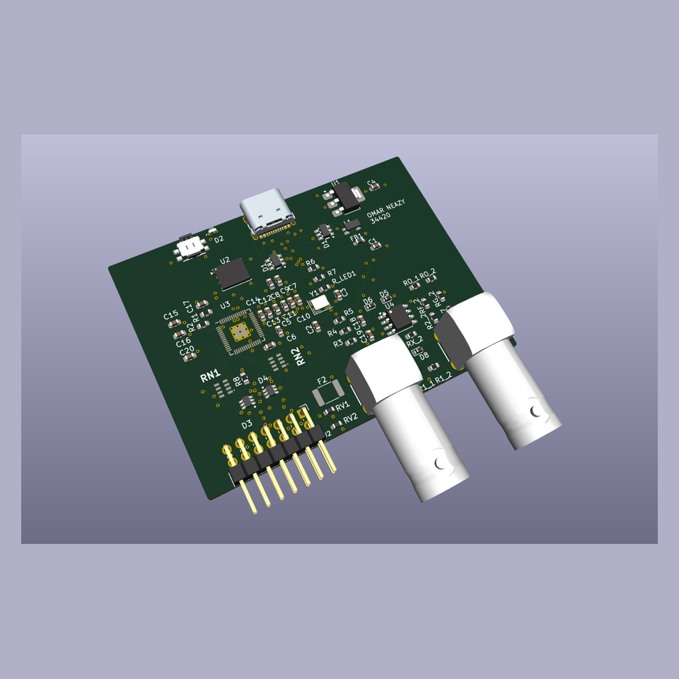
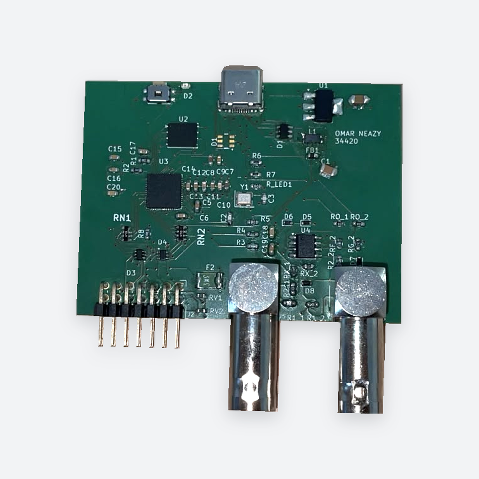
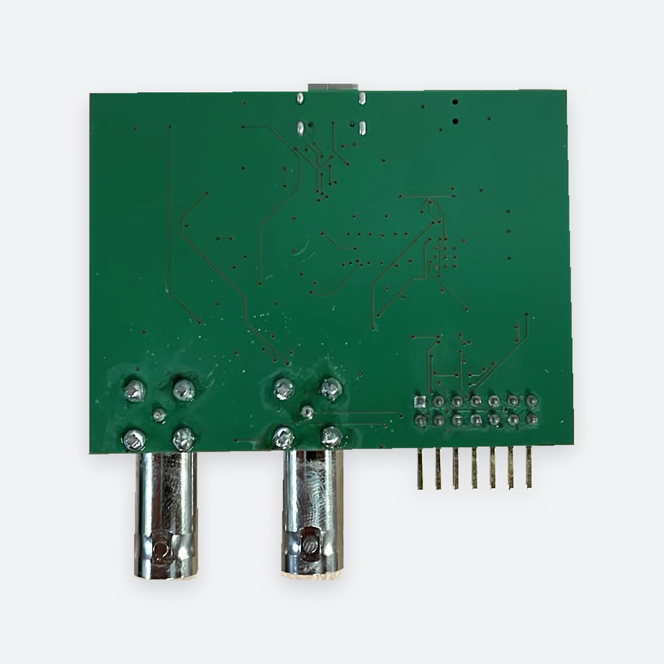
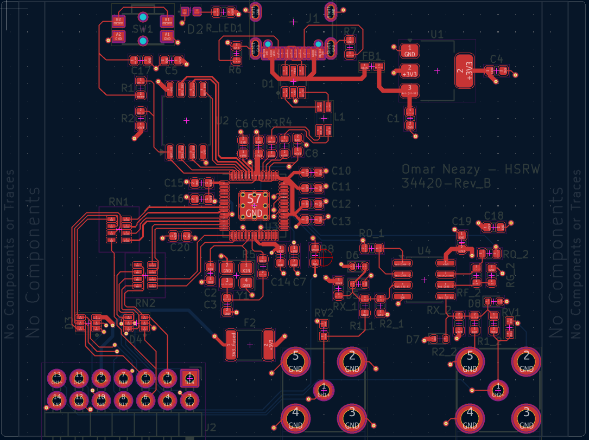
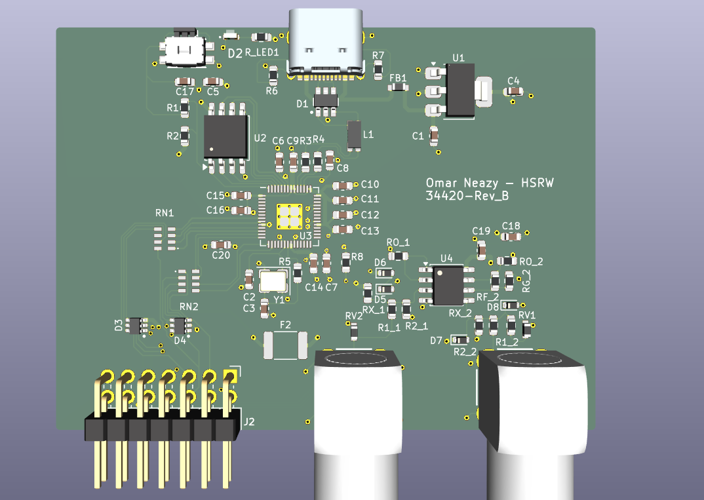

# Scoppy RP2040 Oscilloscope

**Four-layer PCB layout · SMD assembly and rework · Hardware testing · USB fault isolation**

This project is a compact RP2040-based oscilloscope with two analog input channels, a digital input header and a USB-C connection to the Scoppy Android application.

I completed the project individually as part of Design and Manufacturing of Electronics at Hochschule Rhein-Waal. Starting with the course-provided circuit schematic and mechanical template, I completed the four-layer PCB placement and routing in KiCad, assembled the SMD components, and debugged and tested the hardware until I had a working prototype. This included troubleshooting the USB-C interface and locating a short underneath L1.

**Final result:** the board successfully loads the firmware, connects to the Scoppy application, acquires input signals and generates output signals.

  

[Original enclosure photograph](images/enclosure-original.jpg) · [All project photographs](images/README.md)

## My work

- Placed and routed the PCB in KiCad within the required board outline and connector positions.
- Implemented a four-layer stack-up with internal ground and 3.3 V planes.
- Assembled the SMD components using stencil-applied solder paste, paste dispensing and reflow soldering.
- Used a heated bed, hot-air rework and hand soldering for component replacement and connection repairs.
- Performed voltage, resistance and continuity measurements during hardware bring-up.
- Traced a USB data-line short, reworked the USB-C connector and replaced L1.
- Loaded the firmware and completed functional tests with the Scoppy application.

## Hardware overview

| Area | Implementation |
|---|---|
| Microcontroller | RP2040 |
| Program storage | External W25Q128-family QSPI flash |
| Analog frontend | Two MCP6002-based input channels |
| Host connection | USB-C |
| PCB | Four copper layers with internal GND and +3V3 planes |
| Digital interface | Header for digital inputs and expansion |
| Enclosure | PCB and connectors integrated into the course enclosure |

## System overview

## Revision A PCB layout and 3D view

  

<em>Revision A PCB placement and routing in KiCad.</em>

  

<em>Revision A 3D view showing component placement and connector arrangement.</em>

## PCB design and SMD assembly

  

I routed the PCB around the fixed connector positions and enclosure dimensions and implemented the required four-layer arrangement with internal ground and 3.3 V planes.

For assembly, I applied solder paste using both a stencil and a solder-paste dispenser. I used the reflow oven for the RP2040 and several of the smaller-pad SMD components. I used a heated bed/preheater, hot-air station and soldering iron for the remaining assembly, component rework, hand soldering and connection repairs.

This included repeated rework of the small USB-C connector pads and replacement of L1 while debugging the USB connection.

  

[Original PCB photographs](images/README.md)

## Bring-up and USB repair

The board powered up and the status LED illuminated, but it initially failed to enumerate over USB. I checked the power rails first and then followed the D+ and D− paths through the protection, filtering and series-resistor network.

| Measurement | Result |
|---|---:|
| USB supply | 5.15 V |
| 3.3 V rail | 3.34 V |
| RP2040 core rail | 1.09 V |
| RUN input | 3.26 V |
| USB series resistors | Approximately 27 Ω each |
| D+ to D− at the USB-side network | Approximately 0.7–0.8 Ω |
| Between the RP2040-side pads of R3 and R4 | 54.01 Ω |
| Directly between the RP2040 USB D+ and D− pins | 52.7 Ω |

The supply and reset measurements were normal. The approximately 54 Ω reading matched the two 27 Ω series resistors connected through an upstream short, focusing the investigation on the USB connector, protection and filtering network. Supporting checks found no hard shorts from the USB data lines to ground or VBUS, and the BOOTSEL path and crystal-network connections passed static continuity checks.

I found a short underneath L1, removed and replaced the component, and confirmed that the data-line short was gone. I also desoldered and resoldered J1 several times to correct soldering shorts around its fine-pitch USB-C data and power pads. After the rework, USB communication worked and I completed the firmware and Scoppy functional checks.

[Read the Testing and Repair Report →](docs/testing-and-repair-report.md)

## Functional result

After the repair I:

- loaded the RP2040 firmware successfully;
- established a USB connection;
- connected the board to the Scoppy Android application;
- acquired input signals through the oscilloscope channels; and
- used the signal-generation function successfully.

Revision A is the assembled and functionally tested prototype. I then developed Revision B to refine the PCB layout while retaining the circuit architecture and enclosure constraints.

## Revision B — PCB layout improvements

After bringing up Revision A, I redesigned the component placement and routing to give the power, digital and analog sections a clearer arrangement. I retained the four-layer stack-up, internal GND and +3V3 planes, board outline and connector positions.

  

<em>Revision B component placement and routing.</em>

| Change | Purpose |
|---|---|
| Reorganised the power, RP2040 and analog sections | Make the layout easier to follow during assembly, inspection and probing |
| Reworked the crystal network and routed XIN/XOUT entirely on the front layer, removing four vias | Reduce layer changes in the oscillator connections and keep the network together |
| Removed an unused via from the USB D+ route | Remove an unused via barrel and improve symmetry between the data lines |
| Used 0.6 mm vias with 0.3 mm drills, retaining 0.5/0.3 mm vias where space required | Provide larger copper rings around the drilled holes while allowing compact routing |

  

<em>Revision B PCB 3D view.</em>

Revision B documents the completed PCB layout improvements. The assembly, repair and functional results above describe Revision A.

[Open the Revision B KiCad project files →](hardware/revision-b/)

## Repository contents

| Location | Contents |
|---|---|
| [hardware/revision-a](hardware/revision-a/) | KiCad project, schematics, PCB layout and project libraries |
| [hardware/revision-b](hardware/revision-b/) | Revised KiCad project, schematics, PCB layout and project libraries |
| [docs/testing-and-repair-report.md](docs/testing-and-repair-report.md) | Hardware measurements, USB fault isolation, repair steps and final functional tests |
| [images](images/) | Presentation photographs and links to the original photographs |
| [SOURCE_ATTRIBUTION.md](SOURCE_ATTRIBUTION.md) | Course and Scoppy source acknowledgement |

Open `hardware/revision-a/Scoppy34420file.kicad_pro` for the prototype or `hardware/revision-b/Scoppy_Revision_B.kicad_pro` for the revised layout. Keep each project's adjacent schematics, library folders and tables together.

## Skills demonstrated

KiCad PCB layout · Four-layer PCB design · SMD assembly · Solder-paste application · Reflow soldering · Hot-air rework · Hand soldering · Multimeter testing · USB fault isolation · RP2040 hardware bring-up · Technical documentation

**Omar Neazy** · Mechatronic Systems Engineering B.Sc. · Hochschule Rhein-Waal

