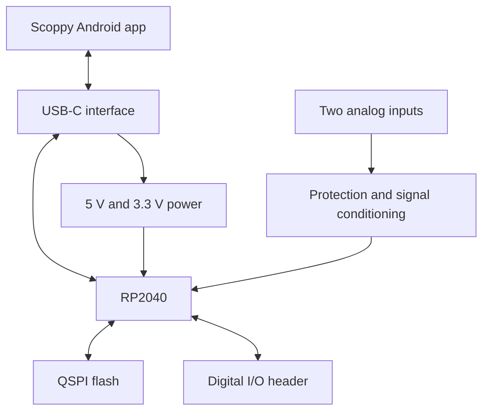

# Scoppy RP2040 Oscilloscope

**Four-layer PCB layout · SMD assembly and rework · Hardware testing · USB fault isolation**

This project is a compact RP2040-based oscilloscope with two analog input channels, a digital input header and a USB-C connection to the Scoppy Android application.

I completed the project individually as part of Design and Manufacturing of Electronics at Hochschule Rhein-Waal. Starting with the course-provided circuit schematic and mechanical template, I completed the four-layer PCB placement and routing in KiCad, assembled the SMD components, and debugged and tested the hardware until I had a working prototype. This included troubleshooting the USB-C interface and locating a short around L1.

**Final result:** the board successfully loads the firmware, connects to the Scoppy application, acquires input signals and generates output signals.

[Original enclosure photograph](images/enclosure-original.jpg) · [All project photographs](images/README.md)

## My work

- Placed and routed the PCB in KiCad within the required board outline and connector positions.
- Implemented a four-layer stack-up with internal ground and 3.3 V planes.
- Assembled the SMD components using stencil-applied solder paste, paste dispensing and reflow soldering.
- Used a heated bed, hot-air rework and hand soldering for component replacement and connection repairs.
- Performed voltage, resistance and continuity measurements during hardware bring-up.
- Traced a USB data-line short, reworked the USB-C connector and replaced L1.
- Loaded the firmware and completed functional tests with the Scoppy application.

## Hardware overview

| Area | Implementation |
|---|---|
| Microcontroller | RP2040 |
| Program storage | External W25Q128-family QSPI flash |
| Analog frontend | Two MCP6002-based input channels |
| Host connection | USB-C |
| PCB | Four copper layers with internal GND and +3V3 planes |
| Digital interface | Header for digital inputs and expansion |
| Enclosure | PCB and connectors integrated into the course enclosure |

## System overview

## Revision A PCB layout and 3D view

*Revision A PCB placement and routing in KiCad.*

*Revision A 3D view showing component placement and connector arrangement.*

## PCB design and SMD assembly

I routed the PCB around the fixed connector positions and enclosure dimensions and implemented the required four-layer arrangement with internal ground and 3.3 V planes.

For assembly, I applied solder paste using both a stencil and a solder-paste dispenser. I used the reflow oven for the RP2040 and several of the smaller-pad SMD components. I used a heated bed/preheater, hot-air station and soldering iron for the remaining assembly, component rework, hand soldering and connection repairs.

This included repeated rework of the small USB-C connector pads and replacement of L1 while debugging the USB connection.

[Original PCB photographs](images/README.md)

## Bring-up and USB repair

The board powered up and the status LED illuminated, but it initially failed to enumerate over USB. I checked the power rails first and then followed the D+ and D− paths through the protection, filtering and series-resistor network.

| Measurement | Result |
|---|---:|
| USB supply | 5.15 V |
| 3.3 V rail | 3.34 V |
| RP2040 core rail | 1.09 V |
| RUN input | 3.26 V |
| USB series resistors | Approximately 27 Ω each |
| D+ to D− at the USB-side network | Approximately 0.7–0.8 Ω |
| D+ to D− on the MCU side of both resistors | Approximately 52.7–54.01 Ω |

The measurements showed that the power system was operating and placed the short on the USB side of the series resistors. I found a short underneath/around L1, replaced the component and confirmed that the short was gone. I also desoldered and resoldered the USB-C connector to correct the small data and power-pad connections.

[Read the Testing and Repair Report →](docs/testing-and-repair-report.md)

## Functional result

After the repair I:

- loaded the RP2040 firmware successfully;
- established a USB connection;
- connected the board to the Scoppy Android application;
- acquired input signals through the oscilloscope channels; and
- used the signal-generation function successfully.

The finished board is a working prototype. A future layout pass can improve component spacing, routing clarity and access for soldering and probing while keeping the tested circuit architecture.

## Repository contents

| Location | Contents |
|---|---|
| [hardware/revision-a](hardware/revision-a/) | KiCad project, schematics, PCB layout and project libraries |
| [docs/testing-and-repair-report.md](docs/testing-and-repair-report.md) | Hardware measurements, USB fault isolation, repair steps and final functional tests |
| [images](images/) | Presentation photographs and links to the original photographs |
| [SOURCE_ATTRIBUTION.md](SOURCE_ATTRIBUTION.md) | Course and Scoppy source acknowledgement |

Open `hardware/revision-a/Scoppy34420file.kicad_pro` in KiCad with the adjacent library folders and tables kept together.

## Skills demonstrated

KiCad PCB layout · Four-layer PCB design · SMD assembly · Solder-paste application · Reflow soldering · Hot-air rework · Hand soldering · Multimeter testing · USB fault isolation · RP2040 hardware bring-up · Technical documentation

**Omar Neazy** · Mechatronic Systems Engineering B.Sc. · Hochschule Rhein-Waal

