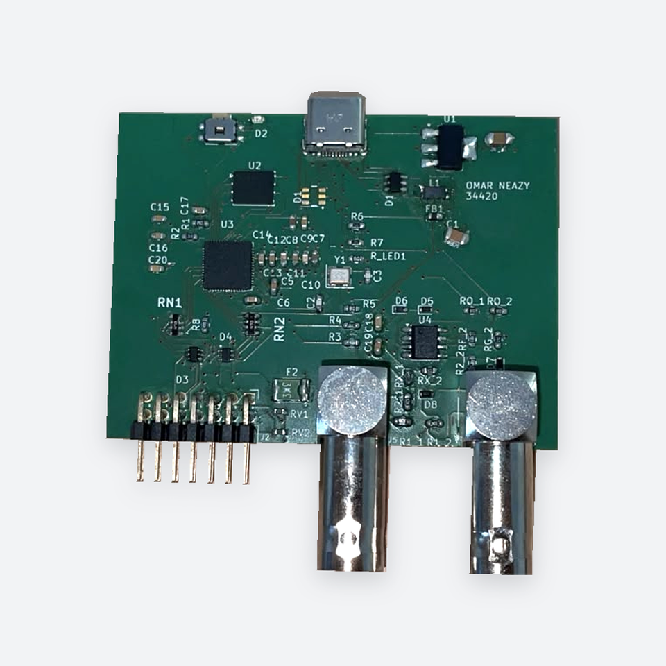
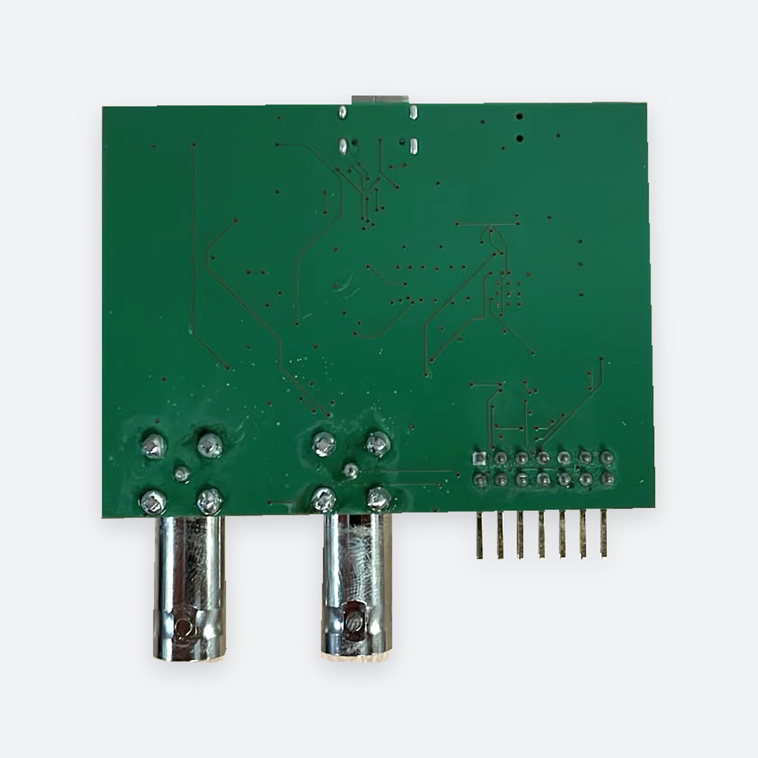

# Testing and Repair Report

## Project outcome

I assembled the PCB and debugged and tested the hardware until I had a working prototype. The completed board loads firmware, connects to the Scoppy Android application, acquires signals and generates signals.

  

[Original PCB photograph](../images/pcb-top-original.jpg) · [All project photographs](../images/README.md)

## Assembly process

I used the following equipment during assembly and repair:

- solder-paste stencil;
- solder-paste dispenser;
- heated bed/preheater;
- reflow oven;
- soldering iron; and
- hot-air rework station.

I applied solder paste using the stencil and solder-paste dispenser. I used the reflow oven for the RP2040 and several of the smaller-pad SMD components. The heated bed, hot-air station and soldering iron were used for the remaining assembly, hand soldering, desoldering and component rework.

## Initial bring-up

The board received USB power and the green indicator illuminated, but Windows did not detect the RP2040 USB device. I started with the power system before moving to the USB data path.

Voltage measurements were taken with the board powered. Resistance and continuity measurements were taken with the board disconnected from power.

## Power and control measurements

| Test point | Measured value | Result |
|---|---:|---|
| USB supply at both sides of FB1 | 5.15 V | USB power reached the board |
| U1 regulator output | 3.34 V | 3.3 V rail operating |
| C6 / RP2040 core supply | 1.09 V | Core supply operating |
| RP2040 RUN input | 3.26 V | Reset input high |
| R6 and R7 | Approximately 5 kΩ each | Consistent with the 5.1 kΩ design values |
| SW1 | Open when released, closed when pressed | BOOTSEL switch operating |

These results confirmed that the board was receiving power, the main regulator was working and the RP2040 was not being held in reset.

## USB data-path testing

The USB paths in the PCB are:

| Signal | Connection path |
|---|---|
| D+ | USB-C connector → protection/filter network → R3 → RP2040 USB D+ |
| D− | USB-C connector → protection/filter network → R4 → RP2040 USB D− |

| Test | Measured value | What it showed |
|---|---:|---|
| R3 | Approximately 27 Ω | Correct USB series resistance |
| R4 | Approximately 27 Ω | Correct USB series resistance |
| D+ to D− at the USB-side network | Approximately 0.7–0.8 Ω | Low-resistance short between the data lines |
| Multimeter probe baseline | Approximately 0.6 Ω | Confirmed that the D+/D− reading was close to a direct short |
| Between the RP2040-side pads of R3 and R4 | 54.01 Ω | Consistent with both 27 Ω resistors connected through an upstream short |
| Directly between the RP2040 USB D+ and D− pins | 52.7 Ω | Supported the upstream-short diagnosis rather than a direct bridge between the RP2040 USB pins |
| End-to-end D+ and D− paths | Approximately 30 Ω each | Data paths passed through their series resistors |

The approximately 54 Ω reading was especially useful: it matched the two 27 Ω resistors in series through the short on the connector side. This focused the repair on the USB connector, protection components and L1 rather than the RP2040 side of the circuit.

## Additional component checks

| Component or section | Measurement |
|---|---:|
| Digital R1 | 989 Ω |
| Crystal-network R5 | 1002 Ω |
| Analog R1_1 | Approximately 460 kΩ |
| Analog R1_2 | Approximately 320 kΩ |
| RV1 | Approximately 516 kΩ in circuit |
| RV2 | Approximately 600 kΩ in circuit |

## Supporting checks

| Check | Recorded result | Interpretation |
|---|---|---|
| USB data lines to GND | Over-range on the selected resistance range at all four tested D1 data pads | No hard data-to-ground short detected |
| USB data lines to VBUS | Over-range on the selected resistance range at all four tested D1 data pads | No hard data-to-VBUS short detected |
| BOOTSEL path | Continuity from U2 to R1, from R1 to the switch node, and from the switch ground terminal to GND; SW1 closed when pressed | Resistor, switch and associated connections behaved as expected |
| USB-C configuration resistors | R6 and R7 measured approximately 5 kΩ each, with one side of each connected to GND | Consistent with the intended CC pull-down network |
| Crystal network | Continuity through the corresponding Y1, R5 and RP2040 XIN/XOUT connections; both crystal ground pads connected to GND | Static connections checked; oscillation was not measured during these tests |
| QSPI flash pins | No hard shorts to GND detected on the tested signal pins | No obvious QSPI signal-to-ground bridge found |

These supporting checks helped narrow the investigation. The low resistance between D+ and D− remained the main fault to isolate.

## Repair

I found a short underneath L1. I removed and replaced L1, then repeated the resistance checks and confirmed that the USB data-line short was no longer present.

J1 also required repeated rework to correct soldering shorts around its fine-pitch USB-C data and power pads. I desoldered and resoldered the connector several times until the connections were correct. After the rework, USB communication worked and the board completed the functional checks below.

## Final validation

| Functional check | Result |
|---|---|
| Firmware loading | Successful |
| USB connection | Successful |
| Scoppy app connection | Successful |
| Signal acquisition | Successful |
| Signal generation | Successful |

  

[Original underside photograph](../images/pcb-bottom-original.jpg) · [Photo sources](../images/README.md)

## What I learned

- How to assemble a mixed SMD PCB using stencil, reflow and manual rework techniques.
- How to separate power, reset and USB data-path problems during bring-up.
- How to use series resistors as measurement boundaries during fault isolation.
- How probe resistance affects low-ohm measurements.
- How to inspect and rework small USB-C and filter-component pads.
- How to verify a repair through repeated electrical and functional testing.

